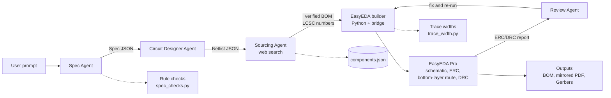

# Architecture

LLM agents make decisions. Plain Python code and EasyEDA Pro do all geometry.
The LLM never writes EasyEDA code: Python turns the netlist into fixed EasyEDA API calls.

| Stage | Type | Owner | Sprint |
|---|---|---|---|
| Spec Agent | LLM agent | Afaq | 1-2 |
| Circuit Designer Agent | LLM agent + templates | Afaq, Hamdan | 2 |
| Sourcing Agent | LLM agent + web search + LCSC check | Hamna | 3 |
| EasyEDA builder | Deterministic Python + EasyEDA API | Shammas, Hamdan | 1-3 |
| Review Agent | LLM agent | Afaq | 3 |
| UI and export | Streamlit + EasyEDA export | Hamna | 4 |
